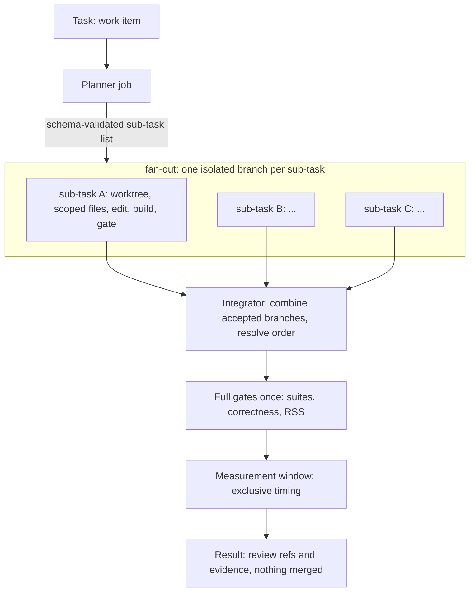

> **Read this first (2026-11-14).** This document is the ORIGINAL design (2026-11-09) and is kept as the record of the reasoning. It has not been revised as
> the code grew, so where it differs from the code, the code and these documents are right: `docs/ITERATION_PROGRESS.md` (what is built and proven),
> `docs/PROCESS_DESIGN.md` sections 13 and 14 (workflows as stages of data; self-mending), `docs/CANVAS.md` (the canvas and forked sections),
> `docs/COMPONENTS.md` (layers), `docs/INTERVENTIONS.md` (every defect found and its mend). Not in this document at all: processes and stages, the predicate
> language, the mends table, the fork executor, contract-first sections, the build id check, capacity classes.

> **Origin:** moved here from Sub0Llm (`docs/design/AGENT_WORKER_FRAMEWORK.md`, branch `docs/agent-worker-framework`) on
> 2026-11-09 when the framework became its own project. **This copy is now the source of truth**; the Sub0Llm copy is to be
> reduced to a pointer once this project has a remote. References to `#NN` tickets are Sub0Llm issues until this project has
> its own tracker. The working title `Sub0Squad` is a placeholder (see DECISIONS.md).

# Design: a native toolbox for delegated, parallel, resource-aware agent work

Status: DESIGN, 2026-11-09. Intended to become its own project (working name `sub0squad`, placeholder) with Sub0Llm as one
inference engine among several. Related: #68 (the existing optimisation harness), #77 (goal), #78 (machine test), the
Sub0Pipeline and Sub0Pub libraries. Legend: **[V]** verified in the repo or the library READMEs, **[P]** proposed,
**[U]** unknown until tested.

## 1. Requirements (from the owner)

1. Run work as a **separate background job** that can be delegated to, checked, followed, cancelled and resumed.
2. **Run workers in parallel**, and let one task be **split automatically into sub-tasks** (for example one per function or
   per format to implement), then recombined.
3. Use the existing **sub-pipeline (DAG) tooling and Sub0Pub for messaging**.
4. A **native application**: performant, **without redundancy** (no second scheduler, no second message bus).
5. **Share resources** and schedule **collaboratively** (cores, memory, a model server, build caches, the exclusive
   measurement window).
6. A start of an agentic worker framework that can be **split into a toolbox project** later, with Sub0Llm as an engine.
   **Several engines and runtimes** are supported side by side: llama.cpp and our native Sub0Llm directly (section 8).
8. (Stretch) Support **Claude and Codex workers**, so work can be delegated up to a frontier model when it is too complex or needs
   splitting (section 8a).
7. The LLM engine must support **multiple concurrent users**, and the scheduler must **know the engine's concurrency cap**
   (section 5a).

## 2. What exists and must be reused [V]

| Piece | What it gives | Limits stated by its own docs |
|---|---|---|
| **Sub0Pipeline** (public, C++23) | DAG of jobs with explicit dependencies, fan-out/fan-in, runtime-sized graphs; pluggable executors (inline, thread-per-job, priority pool); per-job names, timeouts, priority, core affinity hints; cancellation tokens; `RunScope` structured teardown; **deferred completion** (a job completes when a handle is signalled from any thread and holds no executor thread while waiting); **remote sub-graphs** (a sub-graph of registered job kinds runs in a worker process behind an `ITransport`, one deferred job on the coordinator; pipe and in-memory loopback transports shipped); `Payload` (inline up to 64 KiB, or a handle up to 64 bytes such as a content hash resolved through an `IPayloadStore`; larger payloads use streaming or shared memory); observer events and Chrome-Trace capture | no work stealing; **no cluster-wide scheduling or worker discovery**; no resource arbitration (hints only); socket transport is consumer-supplied |
| **Sub0Pub** (public, C++23) | typed publish/subscribe; a message type decides delivery (runtime broker, or direct calls when receivers are named); transport bridges (`Forward`, `Route`, split-horizon `publishFrom`); `StreamSerializer`/`StreamDeserializer` | **no queue, retries or delivery guarantees**; no network stack or pipe; the default binary format is the in-memory layout, not a portable schema |
| Existing harness (`scripts/optimization/*`) | resumable runs (`state.json`, `optimization-run-1`), a per-run `flock`, fresh detached worktrees per attempt, pinned identities and evidence hashes, process-group teardown of the inference server, `--resume`, bounded budgets, stall packets | single machine, single run at a time, Python, one hard-wired loop |
| `sub0perf` lock | the exclusive "quiet machine" window around inference and timing | advisory, per host, Python |
| Machine facts (this host) | decode cores 0-7, batch cores 0-15 pinned in `perf/optimization/llama-cpp.json`; 29.6 GiB RAM; a 7 GB model server per run | |

A first Python supervisor (submit/status/logs/cancel/wait over a detached process group) was prototyped and **discarded**:
it duplicated what Sub0Pipeline provides and would be a second implementation to retire. What it taught is kept here:
own process group per job so cancel can stop a worker and the server it spawned and verify nothing is left; derive "lost"
from a dead supervisor rather than trusting a stale "running"; distinguish cancelled from failed; keep runs resumable.

## 3. Architecture [P]

```mermaid
flowchart LR
    subgraph clients["Clients (CLI, agents, CI)"]
      CLI[sub0squad submit | status | logs | cancel | wait | resume]
      AG[Agents: Claude Code, Codex, ...]
    end
    subgraph daemon["sub0squad serve (native, one per host)"]
      CO[Coordinator: Sub0Pipeline graphs and executors]
      AR[Resource arbiter: leases, queues, quiet windows]
      BUS[Sub0Pub event bus: typed events]
      JR[(Journal and snapshots)]
      PL[Planner jobs: split a task into a sub-task graph]
      CO --- AR
      CO --- BUS
      BUS --> JR
      PL --> CO
    end
    subgraph workers["Workers (processes, Sub0Pipeline remote sub-graphs)"]
      W1[Worktree builder / editor]
      W2[Evaluator: correctness, RSS, timing]
      W3[Measurement worker: exclusive window]
      W4[Inference client]
    end
    subgraph engines["Inference engines (shared, leased)"]
      E1[llama.cpp server]
      E2[Sub0Llm engine]
    end
    CLI <-->|local socket| daemon
    AG <-->|same API| daemon
    CO <-->|ITransport| workers
    W4 --> E1
    W4 --> E2
```

- **One native binary, `sub0squad`, with subcommands** (`serve` runs the per-host daemon; `submit`, `status`, `logs`, `cancel`, `wait`, `resume` are the client). The daemon hosts a Sub0Pipeline coordinator, the resource arbiter, an event bus and the
  journal. A thin CLI and any agent talk to it over a local socket (named pipe on Windows); it never listens on a network.
- **Workers are processes** hosting registered job kinds (`WorkerHost`), reached through Sub0Pipeline's remote sub-graph
  mechanism. A worker per git worktree isolates edits; an evaluator worker owns builds and checks; a measurement worker
  holds the exclusive window.
- **Engines are leased, shared services**, not owned by one job (section 7).
- **No redundancy rule:** scheduling = Sub0Pipeline, in-process messaging = Sub0Pub, resource admission = the one new
  component (the arbiter), durability = the one new journal. Anything that duplicates one of these is rejected in review.

## 4. Job model and lifecycle [P]

A **job** is a Sub0Pipeline graph (often a single remote sub-graph) plus metadata. States: `queued`, `running`,
`succeeded`, `failed`, `cancelled`, `lost` (supervisor gone without a record), `paused-for-measurement` (section 5).
Each job has an id, owner, pinned input identities (source commit, tool and model hashes, as the harness already
pins them), a resource request, a budget (attempts, wall time, tokens) and an evidence directory.

- **Cancel** is cooperative first (stop token reaches the job through Sub0Pipeline), then escalates to the worker's process
  group, and succeeds only when the arbiter confirms all leases released and no child (including a model server) remains.
  State becomes `cancelled`, never `failed`; the run stays resumable.
- **Resume** requires the same job identity and a non-terminal or cancelled record; interrupted attempts stay recorded
  (the harness's existing rule).
- **Idempotence**: job kinds declare whether re-running is safe; external writes (push, merge, PR) are never automatic
  (the harness's existing "preserve for review, do not promote" rule is a framework invariant).
- **Progress** is a typed event stream plus a snapshot, so a client can ask "what is it doing" without reading logs.

## 5. Resources and collaborative scheduling [P]

Neither Sub0Pipeline (hints only) nor Sub0Pub provides admission control, so the **arbiter** is the new core component.

| Resource | Kind | Notes |
|---|---|---|
| CPU cores (sets) | partitionable | e.g. decode 0-7 and batch 0-15 for inference, build cores for compilers; leases are sets, not counts |
| Memory (MiB) | budgeted | admission refuses a job that would exceed the host budget (29.6 GiB visible here; a model server is about 7 GB, a corpus run about 6 GiB) |
| Model server slot | shared, counted | one warm server serves many jobs; leases are slots, not processes |
| Measurement window | exclusive | the quiet machine needed for timing and for inference-versus-timing separation; the `sub0perf` lock semantics |
| Worktree / build-cache slot | pooled | shared cache dirs (ccache, build trees) reused across sub-tasks; worktrees leased and recycled |

Rules:
1. A job's graph begins with a **deferred acquire job** (completes when the arbiter grants the lease, holding no thread
   while queued) and ends with a release; the lease is scoped to the job so a crash or cancel always releases.
2. **Gang admission**: a job gets all its resources or none (no hold-and-wait deadlocks); leases are taken in a global order.
3. **Priorities and fairness** use Sub0Pipeline's priority hint plus per-owner shares; starvation is reported, not hidden.
4. **Collaborative, not just exclusive**: a long job registers a *yield point* and a *checkpoint*; when a measurement
   window is requested, the arbiter signals running jobs, they reach a yield point, release CPU leases and resume after.
   Non-cooperating jobs are never frozen silently; they either finish first or the window waits (configurable), because a
   frozen job can invalidate its own timing.
5. **Warm sharing**: engines and caches stay alive between jobs under reference-counted leases with an idle timeout.
6. The arbiter publishes every grant, wait and release as events, so waiting time and contention are measurable.

## 5a. Engine concurrency and the cap [P]

Parallel workers all want the model. That only works if the **engine supports several concurrent users** and the scheduler
**knows how many**. Today the answer is one: the checked-in harness profile runs llama.cpp with **one slot at 4,096
context** [V: `perf/optimization/llama-cpu.json`], so sub-task proposals would serialise on the model while edits and builds run
in parallel. The framework must therefore treat engine concurrency as data, not an assumption.

**Capability handshake.** Every engine advertises, and may revise at run time, an `EngineCaps` record:
`maxConcurrentSequences` (slots), `contextPerSequence`, `maxBatchTokens`, `batching` (none, static, continuous),
`memoryPerSequenceMiB`, the **measured** aggregate prefill and decode tokens/s at 1..N concurrent sequences, queue policy
and health. The engine publishes `EngineCapsChanged` (for example when memory pressure lowers the cap) and the arbiter
follows it.

**Scheduler rules.**
1. Slots are the counted, shared resource of section 5: the scheduler **never admits more concurrent inference than the
   current cap**; excess requests queue with per-owner fairness and request deadlines (backpressure, not overload).
2. A job needing N parallel proposals asks for N slots as a gang, or is told the cap and degrades to sequential proposals.
3. The cap is learned, not configured: the machine test (#78) adds an engine-concurrency kernel (aggregate tokens/s and
   per-request latency versus N), and the arbiter's capacity is set from that measurement.
4. Prefill and decode of different jobs may share a step; measurement windows (section 5) still exclude everything else.

**What Sub0Llm needs to be such an engine (new work).** Concurrency is an engine feature, not a wrapper:
- per-sequence state (K/V cache plus recurrent GDN state) and a **batched decode step across sequences**: decode is bound by
  the work per weight, and N sequences share one weight stream per step, so aggregate throughput should rise with N until the
  compute roof (`PERFORMANCE_MODEL.md`). This is the same `project_batch` machinery #74 builds for prefill;
- continuous batching (sequences join and leave between steps), slot admission and an honest `EngineCaps`.

Memory per sequence for the 27B [D, from the model dimensions; the formulas are confirmed in the code]:
K/V = 16 full-attention layers x 1,024 (4 KV heads x 256) x 2 (K,V) x 4 B (F32) = 128 KiB per token, so 4,096 context is
512 MiB; GDN state = `gdn::state_floats` = heads x key-dim x value-dim = 48 x 128 x 128 floats per layer, x 48 layers x 4 B =
144 MiB (conv history extra). About **656 MiB per sequence at 4k context**, against about 5.4 GiB of mapped weights, so a
memory cap of roughly a dozen sequences on this host's budget; compute will probably bind first. Measure it (#78), do not
trust the arithmetic.

## 6. Decomposition: one task, many sub-tasks [P]



- **Planners** are job kinds: deterministic splitters (per function in a header, per file, per format variant, per
  checklist item; our own tickets #31-#41 are one sub-task per format) and model planners that emit a JSON sub-task list
  validated against a schema. A plan is data, recorded in the journal, never executed on trust.
- **Isolation**: each sub-task gets its own detached worktree from a common base, an editable-file allowlist and its own
  budget (the harness's contract). The planner must declare disjoint editable sets; overlap is serialised or rejected,
  so integration conflicts are designed out.
- **Parallel limits come from the arbiter**: edits and builds run in parallel up to the CPU and memory budget; model
  proposals share the leased inference slots; **timing never overlaps anything** (the measurement window).
- **Integrator** applies accepted sub-task branches in a deterministic order onto the base, re-runs the full gates once
  (a per-sub-task pass does not prove the combination), and reports; it never pushes or merges.
- **Graph growth**: a running Sub0Pipeline graph cannot be extended **[V: section 11, crashes]**. Planning is therefore
  staged: the plan stage produces data, the daemon builds and runs the next `Pipeline` from it.

## 7. Messaging and durability [P]

- **In process: Sub0Pub.** Typed events with static wiring where the receivers are known: `JobQueued`, `JobStateChanged`,
  `AttemptFinished`, `LeaseGranted`, `LeaseWaiting`, `LeaseReleased`, `Progress`, `LogLine`, `MeasurementWindowRequested`.
- **Across processes:** the daemon and workers are built together, so Sub0Pub's `StreamSerializer` over the Sub0Pipeline
  transport is acceptable for the live bus **[U: verify layout compatibility checks at connect, as `makeLayout` allows]**.
- **Durability is separate.** Sub0Pub states it provides no queue or delivery guarantees, so the **journal** (append-only,
  versioned, stable schema, snapshot plus replay) is the source of truth for job state, evidence pointers and resume.
  The live bus is a view of the journal, not a second record.
- **Observability** reuses Sub0Pipeline's observer and Chrome-Trace capture for run timelines; status and tooling read the
  journal and the event stream.

## 8. Engines and runtimes: llama.cpp and native Sub0Llm, side by side [P]

The framework supports **several engines and several ways of running each**; no job names an engine, it states what it
needs and the scheduler picks one that can serve it.

| Runtime kind | How it is reached | Examples | Notes |
|---|---|---|---|
| External server | HTTP or stdio to a separately started process | llama.cpp `llama-server` (today) | isolation, easy teardown; the harness's current path |
| Spawned process | the framework starts and owns a child, speaks a framed protocol | `sub0llm` engine binary | same contract as above without a network server |
| **In-process library** | linked into a worker host; calls are function calls | **native Sub0Llm directly**, and `libllama` where wanted | no copy or IPC, mapped weights shared through the page cache across workers, cores and memory accounted by the arbiter |

**One engine seam** for all three (`IEngine`): `capabilities()`, `open(session)`, `generate(request, stream)`,
`cancel`, `close`, plus the capability events of section 5a. The request/response schema is the existing
`optimization-request-1` / `optimization-inference-1` contract (prompt-budget check before generation, schema-constrained
output, token rates, usage, peak RSS, teardown guarantee), so adapters for llama.cpp and Sub0Llm are interchangeable and a
work item can be replayed against both.

**Capabilities decide routing, and refusal is the default.** `EngineCaps` (section 5a) also lists what the engine can do:
maximum context per sequence, **structured or grammar-constrained output**, supported model formats and quant tiers,
sampling controls, streaming, batching mode and measured throughput. A request that exceeds an engine's capabilities is
refused with a reason, never truncated or silently degraded. This matters today: the Sub0Llm chat proving ground is a mapped
128-position backend and has no schema-constrained output, so it cannot serve the harness work items yet [V: harness doc];
llama.cpp can. Routing policy is explicit and recorded: pinned engine (a work item may require one), cheapest capable,
fastest capable, or matched A/B (the same item to both engines under the same seed and budget to compare latency, proposal
quality and cost per accepted candidate).

**Engines are leased services** (section 5): the arbiter owns their slots, cores and memory; a warm instance is shared by
many jobs under reference counts and an idle timeout; an in-process Sub0Llm engine is one more lease holder inside the
worker host that loaded it. Failure handling is uniform: an engine that dies or breaches its RSS limit fails its leases,
and the job's retry policy decides, so a llama.cpp outage can fall back to Sub0Llm for items it is capable of serving, and
the reverse.

Sub0Llm is also a **consumer**: its own kernel-optimisation, qualification and measurement loops (#63, #68, #78) run as job
kinds, so it uses the toolbox instead of growing a copy. Bringing Sub0Llm up as an engine needs the concurrency work in
section 5a (#90), structured-output support, and context beyond the proving ground's 128 positions.

## 8a. Agent workers and frontier escalation (stretch) [P]

An **engine** (section 8) answers one request. An **agent worker** runs a whole agent loop with tools, edits and judgement in
its own isolated worktree. The framework supports both, and treats frontier agents as one more kind of worker so that work
can be **delegated up** when it is too complex or needs splitting.

| Worker kind | How it runs | Notes |
|---|---|---|
| Local engine loop | the existing harness loop on llama.cpp or Sub0Llm | cheap, private, bounded; the baseline |
| Claude worker | headless Claude Code (`claude -p`) in a worktree, with an allowlist of tools and a budget | the same CLI can also be pointed at a local Anthropic-compatible endpoint, which was done with the local Qwen server |
| Codex worker | `codex exec` in a worktree, same contract | |
| Any other agent CLI or API | a registered job kind with the same contract | |

**One worker contract.** A worker receives a work item (goal, constraints, editable-file allowlist, budget, evidence rules),
runs in a fresh detached worktree, and returns a diff, logs and a result. Whatever agent produced it, **the same trusted
evaluator gates decide acceptance** (correctness, memory, measured performance), and nothing is pushed, merged or
promoted automatically. A frontier worker's claim is never evidence; this is the harness's existing rule.

**Escalation policy (recorded, never silent).** A work item states its tiers; the scheduler escalates on explicit signals:
1. the planner marks a sub-task **too complex**, or a plan needs a better split than a local model produced;
2. **stagnation**: the loop's own stall detector fires (the Qwen IQ1_S pass-2 run on 2026-11-09 ended `stalled` after six
   attempts that all returned `no_proposal`, and the earlier pass needed an expert seed: exactly the case to escalate);
3. repeated gate failures on the same sub-task, or a budget about to be exhausted with no accepted gain.
An escalation hands over the continuation packet (best commit, rejected attempts and why, evidence paths), so a frontier
worker starts from the local loop's findings, not from nothing. Cheap tiers go first; a frontier call is a budgeted resource
like any other lease (token and cost caps per item, per owner, per day).

**Frontier as planner, local as implementer.** A frontier model is most valuable for the decomposition step (section 6): it
writes the sub-task graph, and local workers implement the pieces in parallel. The plan is still validated data, never
executed on trust.

**Data governance and safety.** Sending code or evidence to a hosted model is an outward action. Each work item declares what
may leave the machine (public repository content only by default; never secrets, credentials or private-repo content); the
daemon enforces it with an allowlist of paths and a redaction pass, and a frontier tier is **off unless the item enables it**.
Workers get no credentials beyond their own API access, run with an allowlisted tool set in a worktree, and cannot push.
Provider terms, cost and rate limits are configuration, not code.

## 9. Native, and what that buys [P]

Jobs are coarse (minutes), so raw throughput is not the point. Native is chosen for: a **single static binary** with no
Python runtime to version; **deterministic accounting** of cores, memory and processes (affinity, cgroup or process-group
control, exact teardown); **reuse of the Sub0 family libraries** instead of re-implementing them; embeddability in
Sub0Llm tools; and a near-zero idle cost. Budgets to test, not assume: submit/status round trip in milliseconds, daemon idle
CPU effectively zero, journal append without per-event fsync storms.

## 10. Migration and extraction

| Milestone | Deliverable | Gate |
|---|---|---|
| M0 | this design agreed; name, repo and licence decided; Sub0Pipeline/Sub0Pub versions pinned | owner sign-off |
| M1 | `sub0squad` + CLI running the **existing Python harness unchanged as an external job kind** (process job): submit, status, logs, cancel (tree teardown verified, no stray server), wait, resume | cancel leaves no child; `lost` detected; resume works on a real `state.json` |
| M2 | arbiter: core sets, memory budget, exclusive measurement lease, scoped release; journal and replay | two jobs cannot overlap the window; crash releases leases |
| M3 | Sub0Pub event stream, progress snapshots, Chrome-Trace timeline | status without parsing logs |
| M4 | planner and fan-out/fan-in: first splitter = one sub-task per quant format (#34-#41) with disjoint files | integrator re-runs gates once; no overlapping edits |
| M5 | `IEngine` seam with `EngineCaps`, capability-based routing and slot leasing: llama.cpp server (slots > 1) first, then native Sub0Llm as a spawned process and as an in-process library with concurrent sequences | scheduler never exceeds the advertised cap; an over-capability request is refused with a reason; the same item runs on both engines with comparable evidence |
| M6 | own repository; Sub0Llm consumes it as a dependency | Sub0Llm builds and runs its loops from the toolbox |
| M7 (stretch) | agent workers: Claude Code and Codex as worker kinds, escalation policy with continuation packets, budgets and data-governance enforcement | an item stalled locally is continued by a frontier worker from the packet, still gated by the same evaluator; nothing leaves the machine unless enabled |

Port Python pieces to native only when stable and hot (the evaluator and arbiter first); never maintain both.

## 11. Open questions [U]

- ~~Can Sub0Pipeline add jobs to a running graph?~~ **Answered 2026-11-09 [V]: no.** `tests/m0_graph_growth.cpp` makes a running
  job call `pipe.emplace` on its own pipeline: the process crashes with SIGSEGV (the header documents emplace/succeed/precede
  as build-phase only, and the job tables are not safe to grow while workers read them). Two fallbacks are asserted to work by
  the same test and are **the rule for planners**: (a) *staged pipelines*, a plan stage whose output (plain data) builds and
  runs the next `Pipeline` (fan-out/fan-in of N sub-tasks plus an integrator); (b) *nested sub-pipelines*, a running job builds
  and runs its own `Pipeline` on its own executor (take care that nesting cannot exhaust a shared pool: give each level its
  own executor or use a deferred job). The daemon therefore owns a **job-graph builder per stage**, never mutates a live graph.
  The test fails on purpose if a future Sub0Pipeline supports growth, so this decision is revisited rather than forgotten.
- Socket transport for `ITransport` (consumer-supplied; `FrameReader` handles framing) and the Windows equivalent; the previous
  dev machine was Windows.
- Whether CPU yield uses cooperative checkpoints only or also cgroup freezing where available (a user systemd session exists
  here; lingering is off, so units end at logout).
- Layout/ABI compatibility policy for Sub0Pub over a transport between independently built peers.
- Name, repository, licence and ownership of the arbiter and journal formats.
- How sub-task disjointness is verified when a model planner proposes the split.

## 12. Tickets to raise

Framework design sign-off and naming (M0); daemon + CLI wrapping the existing harness (M1); arbiter and journal (M2);
event stream and timeline (M3); planner/fan-out (M4); engine seam and shared server (M5); extraction (M6). Related existing
work: #68 (harness), #78 (machine test, supplies the host facts the arbiter needs), #79 (kernel inventory).

---

# Part B: mock-first foundation, observability, tiers and decisions (added 2026-11-09, owner direction)

Direction for the next phase: build the **whole control loop end to end with mock work** (stub processes, a stub engine, a stub
frontier provider) before any real engine or frontier model is attached. The daemon must be **inspectable** (a monitoring
portal), **accountable** (an append-only ledger of who used which resource for what), **extensible** (each work tool declares its
own metrics and progress, so new tools such as Strata plug in without portal or daemon changes) and **quota-aware** (local-first,
frontier escalation bounded by budgets and a share cap). Real engines (llama.cpp, Sub0Llm, Strata) come after the stub
validation; the frontier tier stays stubbed until the owner enables it in the portal.

## 13. Mock-first strategy

Everything real has a stand-in that is **scripted and deterministic**, so every behaviour (stall, crash, hang, slow, escalate) is a
repeatable end-to-end test and policy changes can be iterated without spending anything.

| Stand-in | What it is | Scripted behaviours |
|---|---|---|
| `mock-worker` (subcommand of the same binary, an external process job) | emits progress and metrics on the event fd, writes an `optimization-run-1`-shaped `state.json`, can spawn a child "server" | run N steps of T ms; fail at step k; stall (no progress); ignore SIGTERM; double-fork/`setsid` an escaping child; crash (SIGSEGV); allocate M MiB; emit custom metrics |
| `mock-engine` | implements `IEngine` and `EngineCaps` with no model | configurable slots, latency per token, tokens/s versus concurrency curve, failure injection, cap revision events |
| `stub-frontier` | implements the frontier provider seam with **no network code at all** | returns canned or templated results; records exactly **what would have been sent** (after redaction) and a notional token and cost estimate; injectable refusals, rate limits, errors |
| scenario files | JSON scripts that tie the above together | e.g. "a hard task: local attempts 1-6 stall, escalate at attempt 4, frontier stub succeeds, integrator gates pass" |

The stub frontier runs the **entire** escalation path (decision, permission check, quota lease, data-governance redaction,
ledger entry flagged `stub`, notional cost). The only thing it does not do is send bytes anywhere. That is how the policy is
tuned before it can spend real quota.

## 14. Work-tool plugin seam: workers, engines, metrics (extensibility)

A **tool** is anything the squad can run: a worker kind (process, native remote kind, agent CLI) or an engine runtime
(llama.cpp, Sub0Llm, Strata, mock). Every tool ships a **manifest** (JSON, versioned `tool-manifest-1`), so adding a tool is
adding a file, not changing the daemon or the portal:

```json
{ "schema": "tool-manifest-1", "name": "optimization-harness", "kind": "worker",
  "run": { "type": "process", "command": ["python3", "${tools}/iterate.py"], "cwd": "${repo}" },
  "resources": { "cores": "build:8", "memoryMiB": 7500, "slots": { "engine": 1 }, "exclusiveWindow": false },
  "tier": "local", "dataClass": "private",
  "idempotent": false, "resumable": true,
  "progress": { "protocol": "event-fd", "adapters": [ { "type": "state-file", "path": "${out}/state.json", "schema": "optimization-run-1" } ] },
  "metrics": [ { "name": "attempts", "unit": "count", "type": "counter", "label": "Attempts" },
               { "name": "accepted", "unit": "count", "type": "counter" },
               { "name": "tokens.out", "unit": "tokens", "type": "counter" },
               { "name": "attempt.seconds", "unit": "s", "type": "histogram", "buckets": [30, 60, 120, 300, 600] } ],
  "panels": [ { "title": "Attempts", "series": ["attempts", "accepted"], "view": "line" } ] }
```

- **Progress without log parsing.** A worker gets an inherited descriptor (env `SUB0SQUAD_EVENT_FD`) and writes one JSON line per
  event (`sub0squad-event-1`: `progress {done,total,phase}`, `metric {name,value,labels}`, `checkpoint`, `yieldPoint`,
  `needs {signal}` for escalation hints, `note`). Legacy tools are wrapped by an **adapter** that derives the same events from
  a file they already write (the optimisation harness: `state.json` gives attempts/`max_attempts`, status, `no_progress`,
  `recoveries`, and the `continuation` block, which is the escalation packet).
- **Metrics are declared, not hard-coded.** The manifest's `metrics` and `panels` give the daemon the name, unit, type,
  labels and a display hint; the portal renders **any** tool generically from that schema. Built-in metrics (section 15)
  exist for every job regardless of tool.
- **Engines** declare `EngineCaps` (section 5a) in the same manifest family (`engine-manifest-1`) plus a runtime kind (server,
  spawned process, in-process library). **Strata** is expected to be one engine runtime among these; it is not in this
  checkout, so its manifest is written when the owner points at it, and nothing in the daemon is Strata-specific.
- **Validation**: the daemon refuses a manifest that is malformed, names an unknown resource or tier, or asks for the frontier
  tier without a data class, and reports why. Manifests are hashed and the hash is recorded with every job (identity).

## 15. Metrics, utilisation and the accountability ledger

Two stores, both native and small, neither a database server:

1. **Metric registry** (live, in memory): counters, gauges, histograms with labels (`job`, `tool`, `engine`, `tier`, `owner`,
   `kind`). Rolling time series in fixed ring buffers (1 s for 15 min, 1 min for 48 h, 1 h for 90 days), flushed to rollup
   files, so the portal draws history without unbounded memory. A Prometheus text endpoint (`/metrics`) exposes the same data to
   external tools. Idle cost is nil: samples are pushed by events and sampled on one low-rate timer (default 1 s while a
   client watches, 15 s otherwise).
2. **Ledger** (durable, append-only, schema `ledger-1`, written next to the journal): one record per **resource use**: who
   (owner, job, sub-task, tool), what (resource and amount), when (start, end), how it was granted (policy decision id), and
   what it cost (core-seconds, MiB-seconds, slot-seconds, tokens in/out, notional or real cost units, tier, `stub` flag).
   The ledger is the answer to "who used what and why": quotas are computed from it, and it is never rewritten.

Built-in metrics (every job, no tool support needed): queue wait, run time, state transitions, core/memory/slot utilisation versus
capacity (per resource and per lease), lease contention, process-tree size and RSS, cancel latency, `lost` count. **Derived
effectiveness metrics** (needed to iterate on policy): accept rate (accepted candidates over attempts), **cost per accepted
candidate** per tier, **frontier share** (frontier tokens/cost over total in a window), escalation rate and its outcome
(did the escalated item then succeed), time-to-first-accept, local-only completion rate.

## 16. Tiers, quotas, permission gate and the decision model

**Tier ladder.** T0 `stub` (mock engines and the stub frontier), T1 small local (e.g. a 27B on llama.cpp, Sub0Llm or Strata), T2
larger or alternative local, T3 frontier (Claude, Codex). Work always starts at the cheapest capable tier. A task that a small local
model completes 100 % stays 100 % local; escalation is per sub-task, not per task.

**Frontier permission gate (default: closed, owner-controlled).** Each frontier provider has a mode: `off` → **`stub`** (the
development default: the full path runs, nothing is sent, notional cost is recorded) → `live` (real calls). Only the **owner,
through the portal's Status and Settings page** (loopback only, per-session token, explicit confirmation, optional expiry and
scope), can move a provider to `live`. The CLI, agents and the MCP identity **cannot** change it or any quota: those endpoints
reject them and the attempt is audited. Every change is an audit record (who, when, from, to, scope, expiry). A work item must
also carry `allowFrontier` and a data class that permits it, so enabling live mode never silently exposes private work.
The default build contains no code path that can send to a hosted model unless a provider module is explicitly compiled in and
its mode is `live`.

**Quotas and the share cap.** Budgets are per tier and per window (item, owner, day, week) over tokens, requests, cost units
and wall time, plus a **frontier share cap** (for example at most 20 % of tokens in a rolling window, and a reserve floor so
interactive Claude Code use is never starved by background squad work). A frontier call is a **quota lease**: the arbiter
grants it only if the budget, the share cap and the permission gate all allow, otherwise the request is denied with the reason,
and the planner or decision policy picks another action (split further, retry locally, ask the owner).

**Decision model.** One seam, `IDecisionPolicy::decide(DecisionContext) → Decision`, where the context holds attempts, stall and
gate-failure signals, the planner's complexity estimate, budget and share-to-date, tier availability and `needs` hints from the
worker, and the decision is `continue | retry | split | escalate(tier) | abort | askOwner` with ordered **reasons** and a
confidence. Implementations: (1) a **rule policy** from configuration (default, transparent, testable); (2) a scored policy;
(3) later a model-based classifier (a local-LLM job) behind the same interface. Every decision is stored with its full input as
a **decision record** in the journal, so a new policy can be **replayed offline against recorded history** (`sub0squad policy
replay`) and compared on cost, accept rate and frontier share before it is allowed to decide for real. In stub mode these
records already accumulate from mock and local runs.

**Agent access: tool calls and MCP.** The same control API is exposed as a stdio MCP server (`sub0squad mcp`) so Claude Code or
Codex sessions can inspect and talk to the squad: `squad_status`, `squad_jobs`, `squad_job`, `squad_logs`, `squad_resources`,
`squad_engines`, `squad_budget`, `squad_submit`, `squad_cancel`, `squad_decide` (dry run: what would the policy do for this
context; no side effects), `squad_request_escalation` (files a request that the policy, quota and permission gate answer with
granted or denied and a reason), and `squad_note` (a session posts a message attached to a job). The MCP identity is a normal
client of the daemon: read, submit and cancel its own jobs; never settings, permissions or quotas.

## 17. Observability portal

`sub0squad serve` also serves a **read-mostly web portal on 127.0.0.1** (never a routable interface; Host and Origin checked;
a random per-session token printed at start and stored 0600 under the runtime dir; mutating calls need it; CSRF-safe). One
`ControlApi` core serves three thin front ends: the CLI (unix socket), the MCP server (stdio) and the portal (loopback HTTP
JSON plus a Server-Sent-Events stream; SSE rather than WebSocket keeps the server small and idle-free).

Pages (all driven by the API and the manifest panels, so new tools appear without portal code):
1. **Overview**: queue, running jobs with progress, host utilisation against capacity (cores, memory, slots, measurement
   window), engine health, recent alerts (stalled, lost, quota near limit).
2. **Job detail**: state history, graph of sub-tasks and their states, live log tail, progress, the tool's declared panels,
   leases held and waited on, decisions made and why, evidence links, cancel and resume buttons.
3. **Resources and engines**: per-resource timeline, contention, `EngineCaps` with measured throughput versus concurrency, queue depth.
4. **Usage and accountability**: ledger views by owner, tool, tier and time; cost per accepted candidate; **local versus
   frontier share** against its cap; escalation funnel (requested, granted, denied, succeeded); quota burn-down.
5. **Status and Settings** (owner only): tier and provider modes (`off` / `stub` / `live`), quotas and share cap, data-governance
   allowlists, policy selection, retention; every change confirmed and audited; the live switch shows what a frontier call would
   have sent (from the stub's recorded payloads) so the owner can inspect before enabling.
6. **Audit**: decisions, permission changes, denied attempts, cancellations.

Implementation choice (to confirm with the owner): a single embedded static page (no build step, no framework, assets compiled
into the binary) plus **Boost.Beast and Boost.Asio** (header-only use, pinned through CPM), following the family precedent: Sub0Llm's archived
chapter project (`archive/chapter-education-diffusion`: `cmake/deps.cmake`, `include/sub0llm/http/server.hpp` and `client.hpp`)
**moved from cpp-httplib to Beast**, with a minimal synchronous thread-per-connection `Server` and a blocking `Client`, both
shaped like httplib's API. That code is read, not copied; we write our own small versions against the same shape. Reasons to
follow it: one HTTP stack across the family; the engine adapters need an **HTTP client** as well (llama.cpp `llama-server`, and
likely Strata) and Beast gives client and server; chunked writes cover **SSE** and Beast also has WebSocket if wanted later.
Costs, stated: Sub0Llm pins Boost 1.91.0 and the latest is 1.92.0 (released 2026-08-12); the CMake tarball is about 102 MiB, so
dev machines set `CPM_SOURCE_CACHE` (DEV_SETUP) and only `beast` is requested (`BOOST_INCLUDE_LIBRARIES beast`); Sub0Llm's
server has no streaming response today, which we add. **Redundancy rule:** Asio is **not** a second event loop for the daemon.
The daemon's reactor (control socket, pidfds, timers) stays ours; Asio and Beast run only on the portal's connection threads
and in the engine HTTP client, in the blocking style Sub0Llm uses. The dependency sits behind our own seams (`IHttpFront`:
route, static asset, JSON reply, SSE stream; `IHttpClient`: blocking POST with a streamed body), Beast types never in public
headers (the same rule as simdjson), so the stack can be swapped later. Connection threads call the one thread-safe `ControlApi`.
Idle cost is one blocked accept thread (measured with sub0perf in M3, not assumed). Encoding for the API, journal, ledger and events is JSON through simdjson (section 14, DECISIONS 16).

## 18. Revised milestones (supersedes the table in section 10 where they differ)

| Milestone | Deliverable (all on mock work unless stated) |
|---|---|
| M0 | design, graph-growth answer **done**; name, licence, repo pending the owner |
| M1 | daemon + CLI + control socket, process job kind with its own process tree (verified cancel), crash-safe journal, `lost` detection, event-fd progress, `mock-worker`, state-file adapter and resume on a real `optimization-run-1`; end-to-end test scenarios |
| M2 | arbiter on mock resources (core sets, memory, slots, measurement window), ledger |
| M3 | metric registry, tool manifests and panels, SSE event stream, **portal v0 (read-only)** with Overview, Job detail, Resources |
| M3b | tiers, quotas, share cap, permission gate, decision policy and replay, `stub-frontier`, MCP server, portal Usage, Settings and Audit |
| M4 | planner, staged fan-out and integrator on mock sub-tasks, then the first real splitter |
| M5 | `IEngine` seam; `mock-engine`, then llama.cpp (slots > 1), Sub0Llm (process, in-process), Strata |
| M6 | own repository; Sub0Llm consumes it |
| M7 | **live** frontier providers (Claude Code, Codex) enabled only by the owner in the portal, with governance and budgets proven on the stub first |

## 19. Performance verification uses sub0perf (Sub0Math)

All timing, idle-cost and regression claims are verified with the family's **sub0perf** tooling from Sub0Math (calibrated
interleaved rounds, control benchmarks, per-host baselines, the measuring lock, the pre-push gate), wired in through
`cmake/dependencies.cmake`; ctest keeps the functional and end-to-end gates. The arbiter's exclusive measurement window takes the
same per-repository lock so squad jobs and manual measurements cannot overlap. Budgets and the benchmark list are in
[M1_PLAN.md](M1_PLAN.md) ("Verification with sub0perf").

## 20. Platform seam: Windows and Linux first-class, macOS potential

Everything the OS decides sits behind five small interfaces; no other code includes a platform header. Each platform reports what
it **can** do (`HostFacts`), and the arbiter degrades visibly instead of pretending.

| Interface | Responsibility | Linux | Windows | macOS (potential) |
|---|---|---|---|---|
| `IProcessSupervisor` | spawn a command into a kill-able group, wait handle, enumerate tree, **verify empty**, cooperative stop then forced kill | shim as session leader + `PR_SET_CHILD_SUBREAPER`, `pidfd`, `/proc` | **Job Object** (kill-on-close, process id list), process handle | process group, `kqueue EVFILT_PROC`, `libproc`; escapees not guaranteed |
| `IIpcEndpoint` | control channel, peer identity, framing via `FrameReader` | unix socket 0600 + `SO_PEERCRED` | named pipe with owner-only ACL | unix socket + `LOCAL_PEERCRED` |
| `IRuntimePaths` | state, runtime and cache locations | XDG | `%LOCALAPPDATA%` | `~/Library/Application Support` |
| `IDurableFile` | append, flush, atomic replace, single-instance lock | `fdatasync`, `rename`, `flock` | `FlushFileBuffers`, `ReplaceFileW`, named mutex | `fcntl F_FULLFSYNC`, `rename`, `flock` |
| `IHostFacts` | topology (groups, cores, SMT, NUMA), memory, can-pin, power state | `/sys`, `sched_setaffinity` | processor groups, `SetThreadGroupAffinity` | no hard pinning |

Cooperative stop is a **message**, signals are only a courtesy (section 4 cancel). Workers get an inherited event pipe
(`SUB0SQUAD_EVENT_FD` / `SUB0SQUAD_EVENT_HANDLE`). Windows claims need a Windows run to be true (PLAN_REVIEW A11).

## 21. Diagnostics access: metrics, KPIs and liveness

**Contract.** One versioned `ControlApi` is read by the CLI, the MCP server and the portal (`/api/v1`: `jobs`, `jobs/{id}`,
`jobs/{id}/events` as resumable SSE keyed by journal sequence, `metrics/query`, `kpis`, `ledger?group_by`, `resources`,
`engines`, `budget`, `decisions`, `audit`, `tools`, `health`), plus Prometheus text at `/metrics` and `sub0squad export` (NDJSON or
CSV by time range). Reads are open to the owner's token and to the MCP identity read-only; settings and quotas are owner-only.
Every value carries `asOf` and `source` (`live | journal | rollup`).

**KPIs are data** (`kpi-1`): name, formula over metric and ledger names, window, unit, thresholds, plain definition, shown beside
the value. Built-ins: *local-only completion rate*; *frontier share* (frontier tokens over all tokens, window) against its cap;
*escalation rate* and *escalation success* (escalated sub-tasks that then passed the gates); *cost per accepted candidate* by tier;
*accept rate*; *time to first accept*; *queue wait p50/p95*; *utilisation* per resource (used over leased over capacity);
*lease contention*; *stall rate* and *lost rate*; *cancel latency and verified-clean rate*; *quota burn-down and projected
exhaustion*; *policy regret* from replay (cost the new policy would have saved or added). Tools add KPIs by manifest.

**Liveness, three layers.** (1) **Process**: `/healthz` is answered from the reactor thread, so it proves the loop turns, and
exports `reactor_lag_ms`. (2) **Readiness**: `/readyz` checks the journal is writable, disk headroom, the control endpoint is
bound, engines probe healthy. (3) **Work**: per job, last-event age against the tool's `expectedEventIntervalSec`, shim and worker
handle liveness, engine probes. Stall and `lost` are first-class states, never inferred from log silence.

**Offline diagnostics.** A wedged or dead daemon cannot serve its own portal, so `sub0squad doctor` and `sub0squad portal
--offline` read the journal, ledger, rollups and shim records read-only and render the same pages marked "daemon unreachable,
state as of T". `SIGUSR1` (Windows: a pipe command) dumps internal state to the Sub0Log diagnostic stream; optional systemd
watchdog or Windows service recovery are documented, off by default.

**Agent identity rule (section 16 addition).** An agent or MCP session may submit only a **registered tool manifest by name with
typed parameters**, never a raw command line; raw-command submit is an owner-CLI capability.
